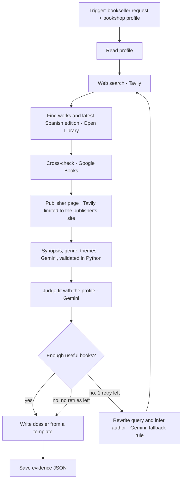

# Editorial Research Agent

**Project 3 · Ironhack AI Consulting · Jaime Garate Marquerie**

An autonomous research agent for **independent bookshops**. The bookseller types an author or a topic; the agent searches the web, finds and verifies the **most recent Spanish edition** of each book, checks the publisher's own page, cross-checks a second catalogue, asks an AI judge how well each book fits the bookshop's cultural profile, and writes a **Markdown dossier with a source for every key fact**.

> **The agent researches and recommends; the bookseller validates and decides.**

- **Presentation slides:** [`presentation/project3_slides.pdf`](presentation/project3_slides.pdf)
- **Demo recording:** DEMO_LINK_PENDING
- **Stack decision:** [`stack_decision.md`](stack_decision.md) (LangGraph)
- **Go-to-market sprints:** [`gtm_future_sprints.md`](gtm_future_sprints.md)
- **Example outputs:** [`samples/`](samples/) (dossiers) and [`evidence/`](evidence/) (JSON logs of every run)

---

## 1. Setup

Requirements: Python 3.11 and three free API keys (Tavily, Google Gemini, Google Books).

```bash
conda create -n proyecto3 python=3.11 -y
conda activate proyecto3
pip install -r requirements.txt
cp .env.example .env        # Windows PowerShell: copy .env.example .env
```

Then open `.env` and add your own keys (names only are listed in `.env.example`; **never commit `.env`**, it is in `.gitignore`):

| Variable | Where to get it | Used for |
|---|---|---|
| `TAVILY_API_KEY` | app.tavily.com (free plan, 1,000 searches/month) | Web search and publisher pages |
| `GEMINI_API_KEY` | aistudio.google.com/apikey (free tier) | AI judge, synopsis/genre/themes, query rewriting |
| `GOOGLE_BOOKS_API_KEY` | Google Cloud Console → enable *Books API* → API key restricted to Books API | Second book catalogue (anonymous quota is 0) |

Open Library needs no key.

## 2. How to run

```bash
python main.py --profile profiles/moscardo.json --query "libros escritos por Leila Guerriero" --author "Leila Guerriero"
```

Equivalent: `python -m editorial_agent.cli ...` with the same options. One-click demo in VS Code: open `run_demo.py` and press Run ▶ (5 works, prints the run time).

| Option | Meaning |
|---|---|
| `--profile` | JSON profile of the bookshop (values, sections, exclusions) |
| `--query` | The bookseller's request, in plain words |
| `--author` | Optional. If missing, the agent can infer it when it rewrites the query |
| `--max-works` | Optional. How many of the author's works to review (1–10, default 5). The demo uses 5 |

By default the agent reviews 5 works (up to 3 editions each), with polite pauses for Open Library. Run time depends mostly on how busy the free Gemini tier is: on 12 Nov a 10-work run took 8 min 50 s because Gemini answered 503 twice and the agent waited and retried; fewer works means fewer calls and a faster run. The terminal prints two paths:

- `samples/dossier_<date>_<id>.md` — the **dossier** for the bookseller
- `evidence/editorial_<timestamp>_<id>.json` — the **evidence**: every tool call, result and error

Self-correction example (no author, ambiguous wording):

```bash
python main.py --profile profiles/moscardo.json --query "obras de Leila Guerriero"
```

Attempt 1 finds 0 books → the agent rewrites the query and infers the author → attempt 2 finds 10 books (see `evidence/editorial_20261111_150400_*.json`).

Free diagnostic for the Gemini key: `python -m editorial_agent.gemini_check gemini-3.5-flash`

## 3. Tests

```bash
pytest
```

47 automated tests. All external services are **mocked** (no network, no cost). They cover the happy path and failure paths: tool errors, retries (429/503/timeouts), fallback model, invalid JSON from the LLM, the self-correction loop and its stop rule, edition selection, publisher-page filters and the "not verified" rules.

Mocked tests prove our logic, not the real services: real runs and their evidence files are in `evidence/`.

## 4. Architecture



**Decision rule (conditional edge):** the research is *enough* if there are at least 2 useful books, or if every book found is useful. Otherwise the agent rewrites the query and searches **once more** (maximum 2 attempts, so it can never loop forever). If a tool fails (web search, profile or judge), it does not retry the search: it writes a dossier marked **NOT FINAL**.

**Grounding (instead of RAG):** there is no vector database. Every bibliographic field comes from a live source with its URL, or it shows **"no verificado"** (not verified). The dossier is filled from a **template**; the LLM never writes it. When Gemini proposes a genre, Python checks that its evidence appears word for word in the publisher's text; synopses must come from a source URL that was actually retrieved. Themes are labelled as the agent's interpretation. Retrieved web text is treated as data, never as instructions (prompt-injection guard).

**Error handling:** retries with waits on 429, 503, timeouts and connection errors; a fallback Gemini model; Google Books stops calling after repeated 429/503; errors from one source never stop the flow; provider error messages are saved without keys.

## 5. Tools and APIs

| Tool | Role | Notes |
|---|---|---|
| **Tavily** | Web search for context; search limited to each publisher's website | Free plan; ~12 search credits per run |
| **Open Library** | Discover the author's works; verify editions, ISBN, publisher, year, pages | No key; ISBN-13 978-84 = published in Spain (not necessarily in Spanish) |
| **Google Books** | Cross-check publisher, date, pages; description; ratings when available | Own key restricted to Books API |
| **Google Gemini** | AI judge, synopsis/genre/themes proposals, query rewriting | `gemini-3.5-flash`, fallback `gemini-3-flash-preview`; free tier |

GDELT (dated news, for "why now?") was tested on 11 Nov but blocked by a per-IP rate limit (HTTP 429); it is planned as future work.

**Cost per report:** $0 on free tiers (about 12 Tavily credits and a few Gemini calls). **Time per run:** 3–9 minutes (depends on how busy the free Gemini tier is).

## 6. File map

| Path | What it is |
|---|---|
| `main.py` | Entry point (`python main.py ...`) |
| `run_demo.py` | One-click demo run with the example request (5 works); prints the run time |
| `editorial_agent/cli.py` | Command-line options; runs the graph and prints the output paths |
| `editorial_agent/graph.py` | The LangGraph agent: state, nodes, conditional edge, tools, validation, dossier template |
| `editorial_agent/profile.py` | Loads and validates the bookshop profile |
| `editorial_agent/gemini_check.py` | Free diagnostic for the Gemini key and models |
| `editorial_agent/tavily_probe.py` | First Tavily test from day 1 (kept as history) |
| `profiles/moscardo.json` | Profile of *La Insumisa*, the founder's own future bookshop (values, sections, exclusions) |
| `profiles/ficha_libreria_moscardo.md` | The same profile in plain words |
| `profiles/publisher_domains.json` | Publisher → official website table, editable by the bookseller |
| `tests/` | Automated tests (mocked services) |
| `samples/` | Dossiers produced by real runs |
| `evidence/` | JSON evidence of each real run |
| `presentation/` | Final slides (PDF and editable PPTX) |
| `docs/architecture.md` | Architecture and failure paths |
| `docs/requirements_checklist.md` | Official deliverables checklist and status |
| `stack_decision.md` | Why LangGraph (and why n8n is secondary) |
| `gtm_future_sprints.md` | Three go-to-market sprints and the ROI hypothesis |
| `.env.example` | Names of the required environment variables (no keys) |

## 7. Known limitations

- Open Library often has no language data: an edition published in Spain can be in Catalan (seen on 11 Nov). Such editions are marked "idioma no verificado"; preferring editions whose title matches the original work is the next fix.
- Not every publisher page is found (only book pages on the official domain are accepted; author pages and press PDFs are rejected). When none is found, the dossier says so.
- The search reviews 5 works per author by default (configurable up to 10 with `--max-works`); some works may not be reviewed. Availability and retail price are not verified.
- Reader ratings: Google Books had no ratings for these titles. Popularity is shown as information only and never lowers a book's position.
- LLM and web results are not deterministic; free tiers can be overloaded. The dossier is marked NOT FINAL instead of guessing.
- The judge tends to accept most books by an author that fits the profile; a ranked recommendation is future work.

## 8. How AI tools were used

Codex (OpenAI) wrote most of the code from detailed requests. Claude (Anthropic) acted as tutor and reviewer: it reviewed changes, ran the tests on a copy and helped write the documentation. The founder defined the problem, the bookshop profile and the product rules (edition vs work, latest edition in print, publisher as primary source, honesty rules), ran every test and real run, and validated the results as a bookseller.
