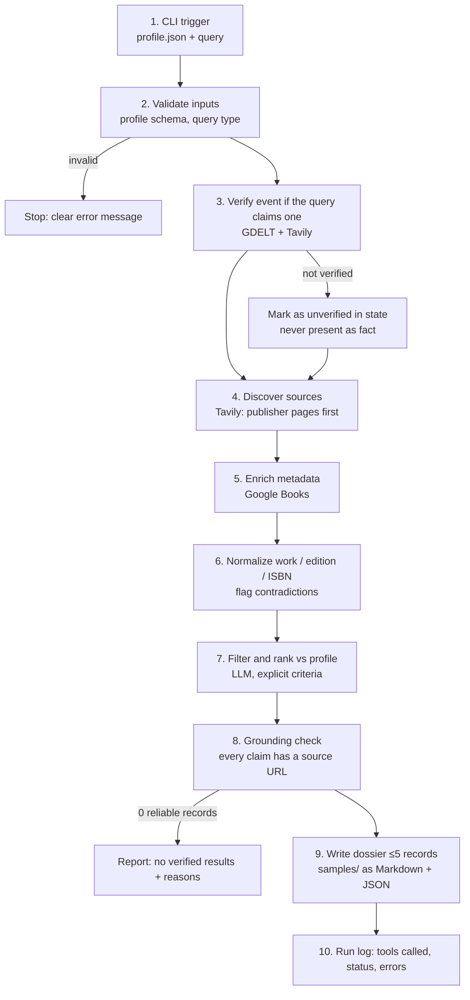

# Architecture — happy path (≤10 steps) and failure paths — DRAFT

## Failure paths
| Failure | Behaviour |
|---------|-----------|
| HTTP 429 / 5xx / timeout | Retry with exponential backoff; if still failing, record `tool_unavailable` in state and continue with partial data, stated in the report |
| Empty results | Not an error: report says "no results found" for that tool |
| LLM call fails | Stop with error; never write a dossier without the LLM step's output |
| Retrieved web text contains instructions | Treated as data only (prompt-injection guard) |
